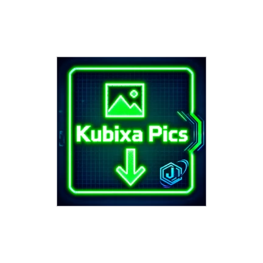
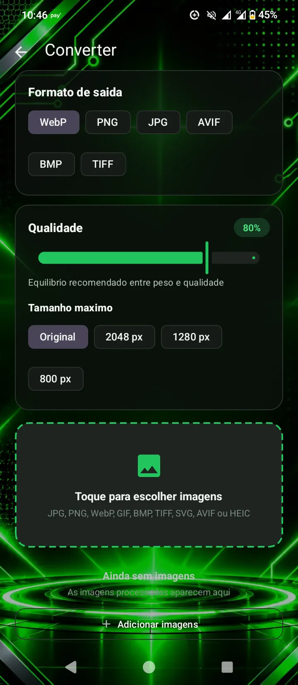
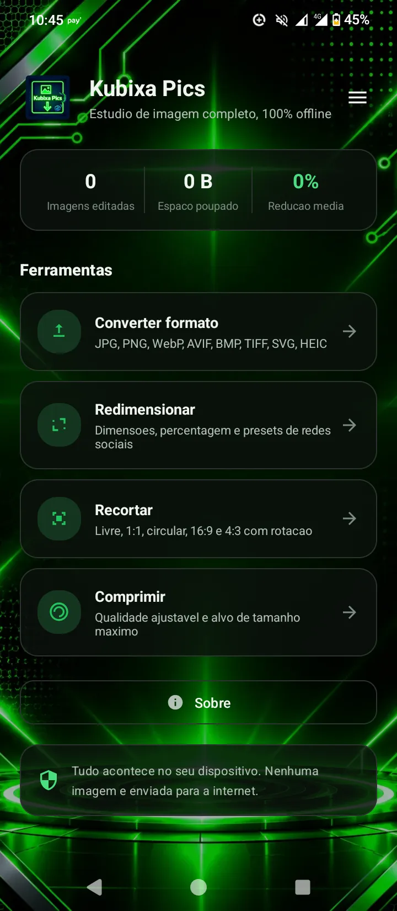
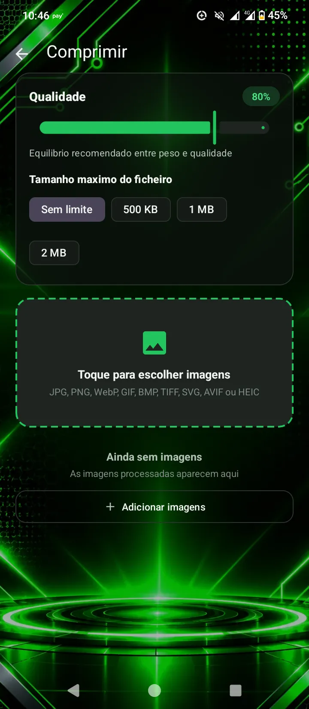

<p align="center">
  
</p>

<h1 align="center">Kubixa Pics</h1>

<p align="center">
  <b>Estúdio de imagem completo para Android.</b><br>
  Converta, redimensione, recorte e comprima imagens — direto no telemóvel, sem enviar nada para a internet.
</p>

<p align="center">
  <a href="https://github.com/julogic404/KubixaPics/releases/latest"><b>⬇️ Baixar o APK</b></a>
  &nbsp;·&nbsp;
  <a href="docs/BUILD.md">Compilar</a>
  &nbsp;·&nbsp;
  <a href="docs/ATUALIZACOES.md">Atualizações</a>
  &nbsp;·&nbsp;
  <a href="LICENSE">Licença</a>
</p>

<p align="center">
  
  
  
</p>

---

## Sobre

O **Kubixa Pics** reúne num só app as quatro ferramentas de que mais precisa para preparar imagens:
**converter** de formato, **redimensionar**, **recortar** e **comprimir**. Tudo é processado no próprio
dispositivo, em lote quando faz sentido, com pré-visualização e com o resultado guardado na sua galeria
em `Pictures/KubixaPics`.

---

## Capturas de ecrã

<table>
  <tr>
    <td align="center"></td>
    <td align="center"></td>
    <td align="center"></td>
    <td align="center"></td>
    <td align="center"></td>
  </tr>
  <tr>
    <td align="center"><sub><b>Principal</b></sub></td>
    <td align="center"><sub><b>Converter</b></sub></td>
    <td align="center"><sub><b>Redimensionar</b></sub></td>
    <td align="center"><sub><b>Recortar</b></sub></td>
    <td align="center"><sub><b>Comprimir</b></sub></td>
  </tr>
</table>

---

## Funcionalidades

### 🔄 Converter formato
- Converte **várias imagens de uma vez** (até 50 por seleção).
- Escolha do formato de saída e da **qualidade** (10–100%) nos formatos que a permitem.
- **Preserva a transparência** quando o formato de saída a suporta (o JPG achata sobre branco).
- Mostra **antes e depois** de cada imagem e um **resumo do lote** (espaço poupado e percentagem).
- **Tamanho máximo** opcional (2048, 1280 ou 800 px) para reduzir a resolução na conversão.
- Corrige automaticamente a **orientação das fotos** (EXIF).

### 📐 Redimensionar
- **Dimensões exatas**, com ou sem manter a proporção (preenche a altura ao escrever a largura, e vice-versa).
- Por **percentagem** (1–400%) ou por **limite máximo** de largura e altura.
- **Predefinições** prontas: Instagram Post (1080×1080), Instagram Story (1080×1920), Facebook Cover (851×315),
  YouTube Thumbnail (1280×720), WhatsApp Profile (500×500), Full HD (1920×1080) e Cover (3000×3000).
- Pré-visualização em tempo real do tamanho final.

### ✂️ Recortar
- Proporções **livre**, **1:1**, **circular**, **16:9** e **4:3**.
- **Rotação** em passos de 90°.
- Moldura arrastável com pegas nos cantos e grelha de terços.
- O recorte circular gera um **PNG com transparência real**.

### 🗜️ Comprimir
- Compressão individual ou **em lote**, com **qualidade ajustável**.
- **Tamanho máximo do ficheiro** (500 KB, 1 MB ou 2 MB): o app reduz a qualidade e, se for preciso, a resolução até a imagem caber.
- Mostra o original contra o comprimido com a **percentagem de redução** (por exemplo, 4,5 MB → 850 KB, −81%).

---

## Formatos suportados

**Entrada:** JPG, PNG, WebP, GIF, BMP, TIFF, SVG, AVIF e HEIC/HEIF.

**Saída:**

| Formato | Transparência | Qualidade ajustável |
|---|:---:|:---:|
| WebP | ✅ | ✅ |
| PNG | ✅ | — (sem perdas) |
| JPG | — | ✅ |
| AVIF | ✅ | ✅ |
| BMP | ✅ | — |
| TIFF | ✅ | — |

---

## Destaques

- 🔒 **Privado:** as suas imagens nunca saem do dispositivo.
- 📴 **Edição 100% offline:** só precisa de internet para verificar atualizações do app.
- 🌍 **Português e inglês:** troca-se no menu ☰ do ecrã principal (ou segue o idioma do sistema).
- 🔔 **Avisos de atualização:** o app compara a sua versão com a última publicada e avisa quando há novidades.
  Há atualizações opcionais e obrigatórias (ver [docs/ATUALIZACOES.md](docs/ATUALIZACOES.md)).
- 📊 **Estatísticas:** no ecrã principal vê quantas imagens converteu e quanto espaço poupou.
- 🎨 **Visual próprio:** tema escuro com fundo neon e ecrã de abertura da marca.
- 🔑 **Sem permissões de leitura:** usa o seletor de fotos do sistema para abrir só as imagens que escolher.

---

## Instalação

1. Abra a página de **[Releases](https://github.com/julogic404/KubixaPics/releases/latest)** e baixe o ficheiro `KubixaPics-vX.Y.Z.apk`.
2. Abra o APK no telemóvel e, se o Android pedir, permita a instalação a partir desta origem.
3. Pronto. O app tem de ter **Android 7.0 (API 24) ou superior**.

Para confirmar a integridade do ficheiro, compare o SHA-256 do APK com o de `SHA256SUMS.txt`, publicado na mesma Release.

---

## Para desenvolvedores

### Tecnologias

| | |
|---|---|
| Linguagem | Kotlin 2.3 · coroutines |
| Interface | Views + ViewBinding · Material Components · ConstraintLayout |
| Build | Android Gradle Plugin 8.13 · Gradle 8.14 · catálogo de versões (`libs.versions.toml`) |
| Imagem | `ImageDecoder` / `BitmapFactory` · EXIF · AndroidSVG · avif-coder (AVIF) · codificadores próprios de BMP e TIFF |
| SDK | `minSdk` 24 · `targetSdk` 35 · `compileSdk` 36 |
| Release | R8 + redução de recursos · assinatura v2/v3 · remoção de logs |

### Estrutura do projeto

O projeto é um **Gradle multi-módulo**: cada ferramenta é um módulo independente que só conhece os módulos de base, e o
`app` é uma camada fina de navegação.

```
KubixaPics/
├── core/
│   ├── common/    modelos e utilitários puros (formatos, presets, eventos)
│   ├── data/      motor de imagem: descodificar, codificar, redimensionar, comprimir, guardar
│   └── ui/        tema, recursos partilhados, adaptador da lista e vista de recorte
├── feature/
│   ├── convert/   conversão de formato
│   ├── resize/    redimensionamento
│   ├── crop/      recorte
│   └── compress/  compressão
└── app/           ecrãs de abertura, principal e Sobre; manifest; ícone
```

```
        app
         │
   ┌─────┼─────┬─────┐
   ▼     ▼     ▼     ▼
convert resize crop compress      (as features não se conhecem entre si)
   └─────┴──┬──┴─────┘
            ▼
   core:ui · core:data ──► core:common
```

Decisões de base:
- O estado vive nos **ViewModels** e sobrevive à rotação do ecrã.
- Todo o processamento pesado corre fora da thread principal, e a lista guarda só miniaturas pequenas e os bytes do resultado.
- A gravação usa **MediaStore** (`Pictures/KubixaPics`) e abre ficheiros pelo **Photo Picker**.
- O motor de imagem (`core:data`) é testável com JUnit sem interface.

### Compilar

```bash
./gradlew :app:assembleDebug      # APK de debug
./gradlew :app:assembleRelease    # APK de release (R8, assinado se houver keystore)
./gradlew :app:bundleRelease      # AAB para a Play Store
./gradlew testDebugUnitTest       # testes unitários
./gradlew lintDebug               # lint
```

Abra a pasta no **Android Studio**, aguarde o Gradle Sync e execute num emulador ou dispositivo.

### Documentação

| Guia | Conteúdo |
|---|---|
| [`docs/BUILD.md`](docs/BUILD.md) | Compilação, variantes, R8/ProGuard, checklist de publicação e estado de segurança do release |
| [`docs/ASSINATURA.md`](docs/ASSINATURA.md) | Criar o keystore, guardá-lo em segredo no GitHub e publicar um APK assinado |
| [`docs/ATUALIZACOES.md`](docs/ATUALIZACOES.md) | Como funciona o aviso de atualização e o ficheiro `versao.json` |

Os workflows do GitHub Actions (CI, release assinado, auditoria de dependências) correm **apenas manualmente**,
na aba **Actions → Run workflow**.

---

## Bibliotecas de terceiros

AndroidX, Material Components, Kotlin Coroutines, [AndroidSVG](https://github.com/BigBadaboom/androidsvg) (Apache 2.0)
e [avif-coder](https://github.com/awxkee/avif-coder) (MIT).

---

## Autor

Desenvolvido por **JuLogic 404** · [github.com/julogic404](https://github.com/julogic404)

---

## Licença

Copyright 2026 JuLogic 404

Distribuído sob a **Apache License, Version 2.0**. Veja o ficheiro [`LICENSE`](LICENSE) e o [`NOTICE`](NOTICE).
Cada ficheiro de código-fonte (Kotlin, Gradle, XML, ProGuard e workflows) leva o cabeçalho padrão de copyright e licença recomendado pela Apache.

```
Licensed under the Apache License, Version 2.0 (the "License");
you may not use this file except in compliance with the License.
You may obtain a copy of the License at

    http://www.apache.org/licenses/LICENSE-2.0

Unless required by applicable law or agreed to in writing, software
distributed under the License is distributed on an "AS IS" BASIS,
WITHOUT WARRANTIES OR CONDITIONS OF ANY KIND, either express or implied.
See the License for the specific language governing permissions and
limitations under the License.
```
